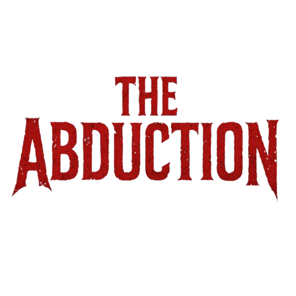

<p align="center">
  
</p>

<h3 align="center">A third-person survival horror puzzle game set inside an abandoned asylum.</h3>

<p align="center">
  
  
  
  
</p>

## About the game

You are trapped inside an abandoned asylum. Armed guards patrol the corridors, and locked doors ask you a riddle
before they let you through. Find keys, pick up health, solve the riddles, avoid the guards, and reach the goal
before your health runs out.

## Features

- **Riddle-locked doors:** 22 doors, each with its own riddle. Walk up, press **E**, type the answer and the door opens.
  Wrong answers give feedback, and a hint prompt appears when you're close enough to interact.
- **Guard AI:** guards patrol between waypoints using Unity's NavMesh, detect the player within a range, stop to aim
  and shoot at a fire rate, then go back to patrolling once you escape.
- **Health and pickups:** health potions, pills and keys, with particle feedback on pickup.
- **Win and lose states:** a win trigger ends the level, and a health bar that reaches zero loads the Game Over scene.
- **Menus:** animated main menu with a dissolve loading transition, pause menu, instructions panel and Game Over menu.
- **Atmosphere:** flickering lights and spooky audio cues around the riddle doors.

## Controls

| Action | Key |
| --- | --- |
| Move | `W` `A` `S` `D` |
| Look / orbit camera | Mouse |
| Run | `Left Shift` (hold) |
| Jump | `Space` |
| Crouch | `C` (toggle) |
| Lie down | `X` (while crouching) |
| Interact (doors, clues, riddles) | `E` |
| Pick up item | `F` |
| Attack (also breaks windows) | Left mouse button |

## Play it

A packaged Windows build is available from the repository's **Releases** page (download the zip, extract it, and run
`The Abduction.exe`). See the build notes in the release description.

## Open the project in Unity

1. Install **Unity 6000.0.53f1** (Unity Hub -> Installs) with the Windows Build Support module.
2. Clone this repository and add the folder in Unity Hub.
3. This repository contains the project's own code, scenes and settings. Third-party asset packs are **not**
   redistributed here (see [Third-party assets](#third-party-assets)). Import them into `Assets/` from the
   Unity Asset Store / their publishers' pages, then open `Assets/--The Abduction--/Scenes/Main Menu (Mobile).unity`.
   Until they are imported, scenes will show missing references.
4. Scenes in the build order: `Main Menu (Mobile)` -> `AA i wish` (the asylum level) -> `GameOverScene`.

## Project structure

```
The-Abduction/
├── Assets/
│   ├── --The Abduction--/
│   │   ├── Scenes/          Main menu, asylum level (AA i wish), Game Over, sample scenes
│   │   ├── Scripts/         Game systems (see table below)
│   │   └── GameOver/        Game Over menu script + image
│   ├── Off_Scripts/         Player movement, camera, guard AI, riddle/clue interaction, pickups, bullets
│   ├── Settings/            URP render pipeline and volume profiles
│   └── InputSystem_Actions.inputactions
├── Packages/                Unity package manifest (URP, Input System, AI Navigation, Timeline, ...)
├── ProjectSettings/         Unity project settings
└── docs/logo.png
```

### Main scripts

| Script | What it does |
| --- | --- |
| `AsylumDoorSystem` | Finds the nearest locked door, shows its riddle, checks the typed answer, unlocks and animates the door, drives the hint text, flicker light and spooky audio |
| `GuardAI` | NavMesh patrol, player detection, aiming and shooting with a fire rate |
| `PlayerController` / `ThirdPersonCamera` | Walk, run, crouch, lie down, jump, actions and an orbit camera |
| `HealthSystem` | Watches the health slider and loads the Game Over scene after a short delay |
| `PickupItems` / `PickupItem` | Health potion, pill and key pickups |
| `RiddleInteraction` / `HiddenClue` | Proximity-triggered riddle panel and readable clues |
| `GameManage` | Pause, resume, instructions panel and returning to the main menu |
| `WinTrigger` | Shows the win panel and disables the AI when the player reaches the goal |
| `menu` / `GameOverMenu` | Main menu loading transition and Game Over buttons |
| `BreakableWindow`, `Bullet`, `Show`, `InstructionUI` | Breakable glass, projectile, key-held state and instruction UI |

## Built with

- **Unity 6** (6000.0.53f1), **Universal Render Pipeline**
- **C#**, Unity **Input System**, **AI Navigation** (NavMesh), **TextMesh Pro**, Timeline

## Third-party assets

The game uses assets and tools made by other people. None of them are included in this repository, and each one
remains under its publisher's own license:

- Invector Third Person Controller and Invector FSM AI Controller
- Dark UI (`Michsky.UI.Dark`)
- Abandoned Asylum environment pack
- Polygon Arsenal, Survival Tools, Rust Key, Ultimate Game Tools (Fracturing)
- Character models and animations: Alien, SWAT, Ninja
- JMO Assets (Cartoon FX / WarFX effects), Low Poly ShotGun Weapon Pack, Weapons and Props Asset Pack
- TextMesh Pro (Unity)

If you are the publisher of one of these and would like the credit changed, please open an issue.

## Status

Playable prototype (version 0.1.0). Known rough edges: some scripts still contain debug logging, and a few
interactions (such as `HiddenClue`) are placeholders.

---

Repository maintained by [@zubiajunaid954-bot](https://github.com/zubiajunaid954-bot).
